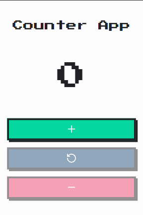
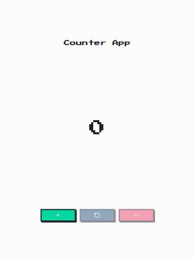
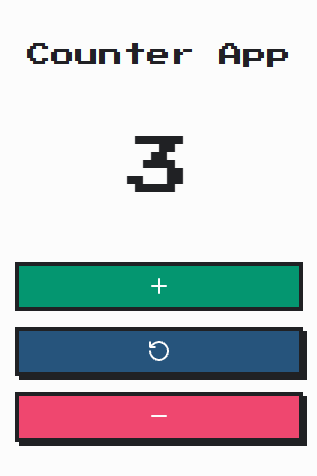

# ➕ Counter App

A responsive and accessible counter app built with vanilla JavaScript, featuring increment, decrement, and reset controls.

---

## 🚀 Live Demo

🔗  [Try the Counter App here](https://counter-app-pearl-chi.vercel.app)

---

## 📸 Screenshots







---

## ✨ Features

- Increment the counter by one.
- Decrement the counter by one.
- Reset the counter to zero.
- Prevent the counter from going below zero by disabling the decrement and reset buttons at zero.
- Use the app on mobile and desktop with a responsive layout.
- Navigate and operate the controls using a keyboard.
- Hear counter updates announced by screen readers.

---

## 🛠️ Tech Stack

### Vanilla

- HTML5
- CSS3
- JavaScript (ES6 Modules)
- Vite
- Lucide
- Google Fonts

---

## 📁 Project Structure

```
counter-app/
├── README.md
├── screenshots/
│   ├── app-interaction.png
│   ├── mobile-view.png
│   └── responsive-design.png
└── vanilla/
    ├── .gitignore
    ├── index.html
    ├── package.json
    ├── package-lock.json
    ├── public/
    │   ├── android-chrome-192x192.png
    │   ├── android-chrome-512x512.png
    │   ├── apple-touch-icon.png
    │   ├── favicon-16x16.png
    │   ├── favicon-32x32.png
    │   ├── favicon.ico
    │   └── site.webmanifest
    └── src/
        ├── assets/
        │   └── fonts/
        │       └── PressStart2P-Regular.ttf
        ├── css/
        │   ├── base/
        │   │   ├── fonts.css
        │   │   ├── normalize.css
        │   │   ├── reset.css
        │   │   └── variables.css
        │   └── main.css
        ├── js/
        │   ├── app.js
        │   └── icon.js
        ├── main.js
        └── style.css
```

---

## 🎯 Learning Objectives

- Practice selecting and updating DOM elements with JavaScript.
- Handle user interactions with event listeners.
- Manage application state and keep the interface synchronized with it.
- Use conditionals to enforce counter limits and control button states.
- Create reusable functions to enable and disable buttons.
- Apply semantic HTML and accessibility practices, including native disabled states and live announcements.
- Organize JavaScript with ES modules and style the app with a mobile-first, responsive approach.

---

## 🔮 Future Improvements

- Add subtle animations and transitions to improve interaction feedback.
- Add a dark mode.
- Rebuild the app with React and Tailwind CSS.

---

## ⚙️ Getting Started

### Prerequisites

- Node.js
- npm

### Vanilla JavaScript

1. Clone the repository:

```bash
   git clone https://github.com/RaulLimon3/counter-app.git
```

2. Navigate to the Vanilla project:

```bash
   cd REPOSITORY/vanilla
```

3. Install dependencies:

```bash
   npm install
```

4. Start the development server:

```bash
   npm run dev
```

---

## 👨‍💻 Author

Developed by **Raúl Limón**  
Frontend Developer focused on building scalable and maintainable web applications while continuously improving JavaScript and frontend architecture skills.

- GitHub: [RaulLimon3](https://github.com/RaulLimon3)  
- LinkedIn: [Raúl Limón]https://www.linkedin.com/in/raul-limon-garcia/